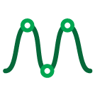

# Curve Noise Generator

A Maya animation curve tool for adding noise, easing, scaling, and baking keyframes — all from interactive sliders that preview changes in real time.

Built for animators who need fast, non-destructive curve adjustments without leaving the Graph Editor. Version 1.2.0 adds an inbetween workflow (bake between two keys, add pinned noise, ease), one-click presets for camera shakes, skids and impacts, and a tabbed layout.



## Layout

The **Channels** filter sits at the top and applies to every tab. Below it are four tabs (the last one used is remembered):

| Tab | Contains |
|---|---|
| **Inbetweens** | Bake, Pin Noise, Ease In, Ease Out — in workflow order |
| **Presets** | One-click Camera Shake, Handheld, Impact Hit, Skid to Stop, Settle Wobble, Rumble Build |
| **Noise** | Noise, Noise Build |
| **Shape** | Scale, Ease, Ease Both |

## Inbetween workflow

1. In the Graph Editor, select the **start key and end key** of a move.
2. Click **1's / 2's / 3's / 4's**. The gap is filled with inbetweens; the two keys you picked are never changed. With **Select inbetweens after bake** on, only the new inbetweens end up selected.
3. Drag **Pin Noise** to add noise to the inbetweens.
4. Drag **Ease In** and/or **Ease Out** to change the timing.

The start and end keys (the unselected keys on either side of the selection) never move while Pin Noise, Ease In or Ease Out are dragged: their values are held and their tangents are switched to *fixed* so the curve through them does not swing. Each press prints a line in the Script Editor naming the keys being edited and the start/end keys being held.

## Presets

Select the start and end key (on one or several curves), set **Amount**, and click a preset. It bakes, eases and adds pinned noise in one undo step; the two keys never move. Amount is the noise size in the channel's units — degrees for rotate, scene units for translate.

| Preset | Result | Recipe |
|---|---|---|
| **Camera Shake** | Random jitter that fades in and out | 1's, random, both ends pinned |
| **Handheld** | Slower, softer drift | 3's, random, both pinned, 0.6× amount |
| **Impact Hit** | Hard rattle that dies away | 1's, zigzag, Decay |
| **Skid to Stop** | Slows into the stop with chatter that dies out | 1's, Ease Out, zigzag, Decay, 0.5× amount |
| **Settle Wobble** | Back-and-forth that settles | 2's, Ease Out, zigzag, Decay |
| **Rumble Build** | Grows from nothing to full strength | 1's, random, start pinned only |

Tips:
- **Camera shake:** key the camera's rotate X and Y at the start and end frame (same values are fine), select both pairs of keys and click Camera Shake. Each channel gets its own random pattern. Try an Amount of 0.5–2.
- **Skid to a stop:** key the travel channel where the skid starts and stops and run Skid to Stop. For extra wobble run Impact Hit with a small amount on a rotate channel.
- 1's gives a fast, buzzy result; 2's–4's a slower, heavier one. Undo and run again for a new random pattern.

## Features

**Bake** — Select two keys and fill between them on 1's, 2's, 3's or 4's, sampled from the current curve. The two keys keep their value, time and tangents (a stepped side facing the inbetweens is switched to auto so the motion does not pop). New inbetweens are marked as breakdowns. Only curves with selected keys are baked; with nothing selected in the Graph Editor, every curve of the selected objects is baked over the timeline range.

**Pin Noise** — Noise on the selected inbetweens. Right = alternating zigzag, left = random; the value is the offset in the attribute's units. **Pin start key** / **Pin end key** fade the noise to zero at that key so there is no pop. **Decay** gives an impact-style falloff: full strength at the start, dying away into the end key.

**Ease In / Ease Out** — Re-time the selected inbetweens between the start and end keys, keeping the shape (including noise). Ease In: right = slow start, left = fast start. Ease Out: right = slow finish, left = fast finish.

**Noise** — Add zigzag or random noise to selected keys. Drag the slider to the right for a strict alternating +/- zigzag pattern, or to the left for a random noise pattern with varying amplitudes. An optional taper checkbox diminishes the noise across the selection.

**Noise Build** — Gradually growing noise designed for flat or static curves. The first and last selected keys stay pinned at their original values while noise builds up toward the middle following a sine envelope. Positive for zigzag, negative for random.

**Scale** — Amplify or compress selected key values relative to a baseline interpolated between the first and last selected keys. Edges stay pinned. An optional "Scale both sides" checkbox shapes the effect with a bell envelope so it tapers at both ends.

**Ease** — Pull selected keys toward a neighboring unselected key using a power-curve envelope. Positive eases out toward the next key after the selection; negative eases in toward the previous key before the selection.

**Ease Both** — Combined ease-in and ease-out. Negative settles/dampens both ends toward their respective neighbor keys. Positive amplifies/overshoots by pushing values away from the interpolated baseline.

**Channel Filter** — TX, TY, TZ, RX, RY, RZ checkboxes restrict which curves are affected. When none are checked, all curves are included.

All sliders snap back to centre on release and the key cache is cleared after each operation, so every drag starts fresh from the current curve state. Full undo support is built in — each slider drag, typed value and preset is a single undo chunk.

Each slider also has a value field: type an exact amount and press Enter to apply it as a single undoable operation. The Min/Max fields beside each section title adjust that slider's range.

## Requirements

- Autodesk Maya 2020 or later (PySide2 or PySide6, bundled with Maya)

## Install

### Drag-and-Drop (recommended)

1. Place all three files in the same folder:

```
install_noise_generator.mel
noise_generator_1_0_0.py
noise_generator_icon.png
```

2. Drag `install_noise_generator.mel` into the Maya viewport.

The installer will:
- Copy the script to your Maya user scripts directory as `noise_generator_1_0_0.py`
- Copy the icon to your Maya user prefs icons directory
- Add a shelf button labeled **Noise Generator** to the currently active shelf

### Manual Install

1. Copy `noise_generator_1_0_0.py` to your Maya scripts directory:

| OS | Path |
|---|---|
| Windows | `C:\Users\<you>\Documents\maya\scripts\` |
| macOS | `~/Library/Preferences/Autodesk/maya/scripts/` |
| Linux | `~/maya/scripts/` |

2. Copy `noise_generator_icon.png` to your Maya prefs icons directory:

| OS | Path |
|---|---|
| Windows | `C:\Users\<you>\Documents\maya\prefs\icons\` |
| macOS | `~/Library/Preferences/Autodesk/maya/prefs/icons/` |
| Linux | `~/maya/prefs/icons/` |

3. Create a shelf button manually, or run this in Maya's Script Editor:

```python
import noise_generator_1_0_0
noise_generator_1_0_0.launch()
```

## Usage

1. Select keys in the Graph Editor (or select objects and highlight a timeline range). For the inbetween workflow and presets, select the start and end key.
2. Click the **Noise Generator** shelf button to open the tool.
3. Drag any slider to preview changes in real time. Release to commit.
4. For precise amounts, type a value into the field beside a slider and press Enter.
5. Use **Ctrl+Z** to undo at any time.

## Files

| File | Description |
|---|---|
| `install_noise_generator.mel` | Drag-and-drop installer for Maya |
| `noise_generator_1_0_0.py` | Main script (v1.2.0) |
| `noise_generator_icon.png` | Shelf icon |

## License

Free to use and modify.
